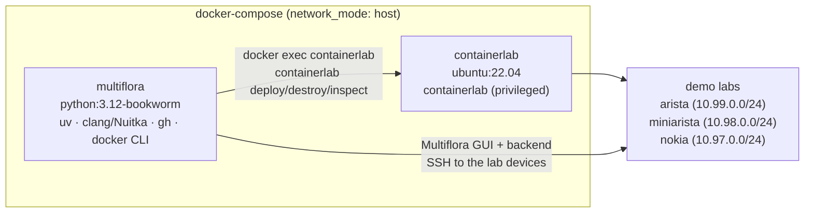

# `.devcontainer/` — development environment

[← Back to the project README](../README.md)

Reproducible development environment for Multiflora, built around two Docker
containers orchestrated by `docker-compose.yml` and wired into VS Code through
`devcontainer.json`.

## Containers



| Service | Image / Dockerfile | Role |
| --- | --- | --- |
| `multiflora` | `multiflora.Dockerfile` (`python:3.12-bookworm`) | Development container: Python 3.12, `uv`, `gh`, Docker CLI and the C toolchain (`clang`, `ccache`, `patchelf`) used by Nuitka |
| `containerlab` | `containerlab.Dockerfile` (`ubuntu:22.04`) | Hosts the Containerlab tool that deploys the demo labs |

### `multiflora` container

- creates the unprivileged user `multiflora` (uid/gid 1000) with passwordless
  `sudo`;
- installs `git`, `build-essential`, `cmake`, `gawk`, `iputils-ping`,
  `openssh-client`, `clang`/`clangd`/`clang-format`, `ccache`, `patchelf`,
  the GitHub CLI and the Docker CLI/plugins;
- installs [uv](https://docs.astral.sh/uv/) and opencode;
- `pid: host`, with the Docker socket and the workspace bind-mounted at the
  same absolute path (`${PWD}:${PWD}`) so paths stay valid inside the
  container;
- runs on the host network, with `DISPLAY` forwarded from the host
  (via `localEnv`) so the Tkinter GUI can open.

### `containerlab` container

- installs the `containerlab` binary from the official installer;
- runs `privileged` with `pid: host`, mounting `/var/run/netns`,
  `/sys/fs/cgroup` and `/lib/modules`, as required to create the cEOS nodes
  and their management network;
- shares the Docker socket and the workspace, and simply keeps running
  (`tail -f /dev/null`) waiting for commands.

## Usage

### VS Code (recommended)

1. Install the **Dev Containers** extension.
2. Open the repository and choose **Reopen in Container**.
3. VS Code attaches to the `multiflora` service with the `containerlab` service
   running alongside; the extensions `ms-python.python`, `ms-python.vscode-pylance`
   and `srl-labs.vscode-containerlab` are installed automatically.

Inside the container:

```bash
make prepare     # create .venv and install requirements.txt
make gui         # open the Multiflora GUI
make exec        # deploy the default Containerlab lab (TARGET=arista)
```

### Plain Docker

```bash
docker compose -f .devcontainer/docker-compose.yml up -d --build
docker exec -it -w "$PWD" multiflora bash
```

The `containerlab` container is only needed for the demo labs; everything else
works from the `multiflora` container (or from the host, with Python 3.12).

## Requirements on the host

- Docker Engine with the Compose plugin;
- the `ceos:4.32.0F` and `ghcr.io/nokia/srlinux:26.7.2` images (imported/pulled
  by Containerlab when the topology is deployed);
- a graphical session when the GUI is used (`DISPLAY` is forwarded into the
  container).

## Files

| File | Description |
| --- | --- |
| `devcontainer.json` | VS Code entry point: targets the `multiflora` service and starts both containers |
| `docker-compose.yml` | Service definitions, mounts, networks and privileges |
| `multiflora.Dockerfile` | Development environment image |
| `containerlab.Dockerfile` | Containerlab helper image |

The lab topologies and sample projects deployed from these containers are
documented in the
[project README](../README.md#demo-labs-with-containerlab).

<!-- Imagem: substituir por uma captura do VS Code no dev container -->
