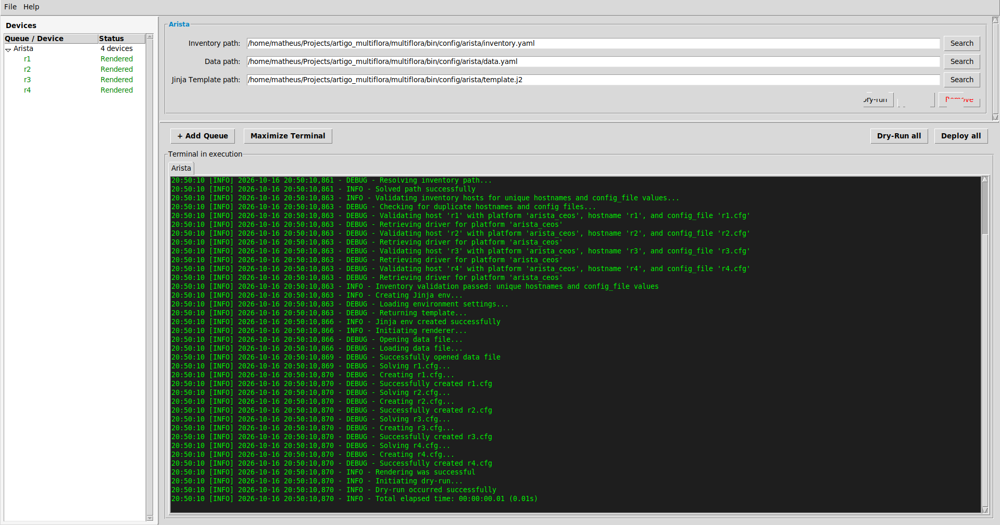
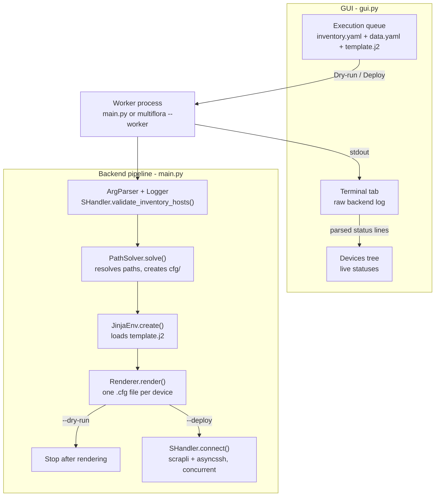
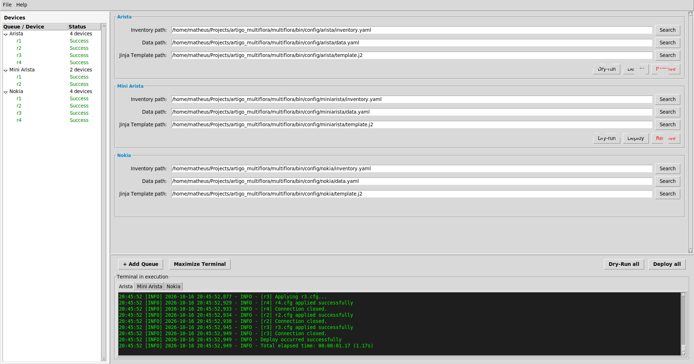
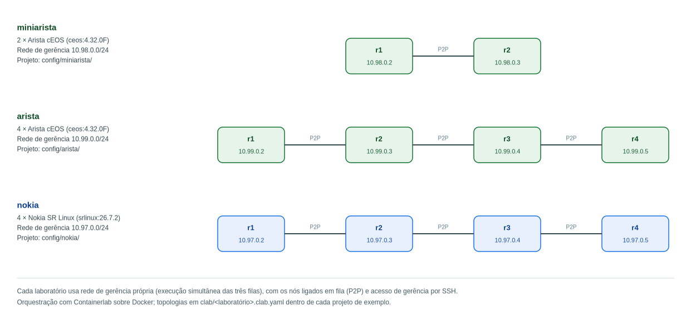

# Multiflora

**Platform for Automation and Deployment of Networks** — a standalone desktop
application that renders network device configurations from Jinja2 templates and
deploys them asynchronously over SSH.

> ⚠️ **Attention:** this version is only a prototype and a proof of concept.

<!-- Imagem: substituir por uma captura da interface principal -->


## Table of contents

- [Overview](#overview)
- [How it works](#how-it-works)
- [Requirements](#requirements)
- [Quick start](#quick-start)
- [Using the GUI](#using-the-gui)
- [Command line](#command-line)
- [Configuration model](#configuration-model)
- [Demo labs with Containerlab](#demo-labs-with-containerlab)
- [Building standalone executables](#building-standalone-executables)
- [Makefile reference](#makefile-reference)
- [Repository layout](#repository-layout)
- [Documentation](#documentation)
- [Troubleshooting](#troubleshooting)
- [Author](#author)

## Overview

Multiflora combines a Tkinter desktop interface with an asynchronous Python
backend:

- **Graphical interface** (`bin/gui.py`) — organizes work into **execution
  queues**. Each queue points to an inventory file (`inventory.yaml`), a data
  file (`data.yaml`) and a Jinja2 template (`template.j2`), and can be executed
  alone or together with every other queue.
- **Backend** (`bin/main.py`) — the routine shared by the command line and by
  the GUI worker process: validates the inventory, renders one `.cfg` file per
  device and, optionally, applies those files to the devices.
- **Rendering pipeline** (`bin/render_pool/`) — filesystem path resolution, the
  Jinja2 environment and the template rendering itself.
- **Deployment pipeline** (`bin/event_pool/`) — asynchronous connections
  (scrapli + asyncssh) with per-device error handling.

Each queue runs in its own background process, so several queues can execute at
the same time while the interface stays responsive. During execution, every
device appears in the **Devices** tree and moves through its lifecycle statuses,
while the raw backend output streams into a **terminal tab** dedicated to that
queue.

Main capabilities:

- Queue-based batch automation: execute one queue, or all of them at once.
- **Dry-run** rendering preview before touching any device.
- Concurrent asynchronous deployment with per-device error isolation (one
  failing host does not stop the others).
- Live device statuses (`Detected`, `Connecting`, `Applying`, `Success`,
  `Rendered`, `Failure`) and a per-queue terminal.
- Project files (`.json`) with session cache, continuous auto-save and crash
  recovery.
- Distribution as a single executable (Nuitka onefile) with automatic desktop
  entry — no Python installation needed on the target machine.
- Bundled Containerlab labs with Arista cEOS (2-node and 4-node topologies) and
  Nokia SR Linux (4-node topology).
- HTML API documentation generated with pdoc.

## How it works



The same backend routine (`bin/main.py`) is used both by the worker process
spawned by the GUI and by the [command line](#command-line):

1. **Arguments & logging** — `ArgParser.parse()` reads the configuration paths
   and the execution mode; `Logger.create()` opens a timestamped log file
   inside the project directory and mirrors everything to the console.
2. **Path resolution** — `PathSolver.solve()` resolves the template path and
   creates the `cfg/` output directory that receives the rendered files.
3. **Inventory loading & validation** — `inventory.yaml` is loaded and
   `SHandler.validate_inventory_hosts()` rejects duplicate `hostname` /
   `config_file` values and unsupported `device_type` values.
4. **Template loading** — `JinjaEnv.create()` builds the Jinja2 environment
   (`trim_blocks` and `lstrip_blocks` enabled).
5. **Rendering** — `Renderer.render()` walks the top-level keys of `data.yaml`
   and writes one `cfg/<config_file>.cfg` per device.
6. **Execution** — `--dry-run` stops after rendering; `--deploy` hands over to
   `SHandler.connect()`, which applies each rendered file to its device with
   one concurrent asynchronous task per host.

The total elapsed time of every run is reported at the end by
`ExecutionTimer`.

## Requirements

| Purpose | Requirement |
| --- | --- |
| Run from source | Python 3.12+ with Tkinter, plus the packages in `requirements.txt` (`jinja2`, `pyyaml`, `scrapli[asyncssh]`) |
| Run the GUI | A graphical desktop session (X11/Wayland) |
| Build executables | Nuitka + clang (or the `.devcontainer` toolchain / the `init` script) |
| Demo lab | Docker + Containerlab (or the provided dev container) |
| API docs | `pdoc` (installed from `requirements.txt`) |

## Quick start

### Option A — from source

```bash
git clone https://github.com/matheusrosafogo/multiflora.git
cd multiflora

# With the Makefile (uses uv):
make prepare   # recreates .venv and installs requirements.txt
make gui       # launches the GUI

# …or manually:
python -m venv .venv
. .venv/bin/activate
pip install -r requirements.txt
python bin/gui.py
```

Then add a queue in the interface and select the sample project files under
`bin/config/miniarista/` (inventory, data and template), and press **Dry-run**.

### Option B — inside the dev container

Open the repository in VS Code and choose **Reopen in Container** — the
[`.devcontainer`](.devcontainer/README.md) starts the `multiflora` and
`containerlab` containers with every dependency installed. After that, run
`make prepare && make gui` (with `DISPLAY` forwarded from the host) or use the
commands from the [demo labs](#demo-labs-with-containerlab) section.

## Using the GUI

### Queues

Every queue is one execution unit with three paths:

| Field | Expected file |
| --- | --- |
| **Inventory path** | `inventory.yaml` (devices and credentials) |
| **Data path** | `data.yaml` (variables consumed by the template) |
| **Jinja Template path** | `template.j2` (how the configuration is written) |

Use **+ Add Queue** to create a queue, click its **title** to rename it (the
log tab and the tree node follow the new name) and **Remove** to delete it.
Paths can be chosen with the **Search** buttons or typed directly; both go
through consistency checks:

- files of the same queue spread across different subdirectories → warning;
- probable inventory/data swap (judged by the file name) → warning;
- the same file used twice in the same queue → hard error;
- a file already used by another queue → warning.

Before a run starts, the GUI also checks that no field is empty, that every file
exists on disk and that no two fields point to the same file.

> The inventory file must live inside a subdirectory of the application's
> `config/` folder (`bin/config/` when running from source). That subdirectory
> becomes the backend working directory, where `cfg/` and `logs/` are created.

### Execution modes

| Button | What it does |
| --- | --- |
| **Dry-run** | Renders every configuration file and stops; no device is touched |
| **Deploy** | Renders and applies the files to the devices over SSH |
| **Dry-Run all / Deploy all** | Runs the mode for every queue at once |

Each run happens in a separate background process, so the GUI never blocks.
When several queues run together they execute in parallel and each one keeps its
own log tab. The current project is auto-saved before every execution.

<!-- Imagem: substituir por uma captura de uma fila em execução -->


### Devices tree

The side bar lists each queue and, below it, every device found in the
inventory, with a live status:

| Status | Meaning |
| --- | --- |
| `Detected` | Host validated in the inventory (with its platform) |
| `Connecting` | SSH connection being established |
| `Applying` | Configuration file being sent |
| `Rendered` | Dry-run finished successfully for this device |
| `Success` | Deploy finished successfully for this device |
| `Failure` | Authentication, timeout, connection or apply error |

### Terminal

Each queue owns a green-on-black terminal tab that receives the raw backend
output, line by line. **Maximize Terminal** (and **Restore Terminal**) toggles
the terminal between its normal height and the whole right side of the window.

### Projects, auto-save and recovery

Project files are plain `.json` files that store the queue set (names and
paths). They are managed from the **File** menu: *New Project*,
*Open Project…*, *Save*, *Save Project As…* and *Exit*.

| Internal file (inside `config/`) | Role |
| --- | --- |
| `.last_project.json` | Session cache: restores the workspace on the next start |
| `.autosave_project.json` | Continuous auto-save (every 30 seconds) for crash recovery |

When the application detects that the previous session ended abruptly — the
auto-save differs from the session cache — it offers to **recover** the pending
changes. On exit, closing with unsaved changes also offers to save them.
Internal cache files cannot be used as project destinations (the app refuses).

## Command line

The backend can be executed without the GUI. Run it from the `bin/` directory
so that imports and relative paths resolve as expected:

```bash
cd bin
python main.py <config_dir> <inventory> <data> <template> <queue_name> \
    [--dry-run | --simulate | --deploy]
```

Examples:

```bash
cd bin

# Render only (no flag behaves exactly like --dry-run):
python main.py config/miniarista/ config/miniarista/inventory.yaml \
    config/miniarista/data.yaml config/miniarista/template.j2 "Mini lab" --dry-run

# Render and deploy:
python main.py config/miniarista/ config/miniarista/inventory.yaml \
    config/miniarista/data.yaml config/miniarista/template.j2 "Mini lab" --deploy
```

| Argument / flag | Description |
| --- | --- |
| `config_dir` | Directory that receives `cfg/` and `logs/` |
| `inventory` | Inventory YAML file |
| `data` | YAML file with the template variables |
| `template` | Jinja2 template |
| `queue_name` | Name used in the log messages |
| `--dry-run` | Render the configurations without deploying them |
| `--simulate` | Reserved simulation mode (currently ignored by the backend) |
| `--deploy` | Render and deploy the configurations to the devices |

Logs are written both to the console and to
`<config_dir>/logs/<YYYY-MM-DD_HH-MM-SS>.log`.

## Configuration model

### `inventory.yaml`

```yaml
all:
  hosts:
    r1:
      device_type: arista_ceos   # selects the driver (see the table below)
      host: 10.98.0.3            # management address
      port: 22
      username: admin
      password: admin
      auth_secondary: admin      # optional (enable password); falls back to password
      hostname: r1               # used to match the data file entries
      config_file: r1.cfg        # output file name (.cfg is appended when missing)
```

### `data.yaml`

Every top-level key is one device. The renderer matches the key,
case-insensitively, against the inventory host name and against its `hostname`
field, and then renders the template with that key's variables:

```yaml
r1:
  hostname: r1
  vlans:
    - id: 10
      name: MANAGEMENT
  interfaces:
    - name: Ethernet1
      description: Uplink
      mode: routed
      ip_address: 10.255.0.2
      netmask: 255.255.255.252
```

### `template.j2`

A regular Jinja2 template; `trim_blocks` and `lstrip_blocks` are enabled, so
block tags do not leave blank lines in the output:

```jinja
hostname {{ hostname }}


vlan {{ vlan.id }}
 name {{ vlan.name }}

```

Missing variables follow Jinja2's default `Undefined` behaviour: they are
printed/iterated as empty and only raise errors when their attributes are
accessed.

### Rendering rules

For every key of `data.yaml`:

1. the inventory is searched (case-insensitively, by host name or by the
   `hostname` field) to find the matching entry;
2. the output name is taken from the entry's `config_file` (falling back to the
   data key) and receives a `.cfg` extension when missing;
3. the template is rendered with that key's variables and written to
   `cfg/<config_file>`.

### Supported platforms

| `device_type` | Driver | Notes |
| --- | --- | --- |
| `arista_eos` | scrapli `AsyncEOSDriver` | Arista EOS |
| `arista_ceos` | scrapli `AsyncEOSDriver` | Arista cEOS (lab) |
| `nokia_srlinux` | `AsyncSRLinuxDriver` (`event_pool/s_handler.py`) | Nokia SR Linux (lab) |

All use the `asyncssh` transport, with strict host key checking disabled
(lab-friendly). Any other value aborts the queue during inventory validation.

The Nokia driver reuses the privilege levels of the
`scrapli_community.nokia.srlinux` platform and adds the candidate-datastore
handling that SR Linux requires: the deployment enters the candidate
configuration, applies the rendered file and commits it; any failure discards
the staged changes. SR Linux also receives an explicit SSH terminal size
(`transport_options`), without which its CLI never reaches the login prompt.

## Demo labs with Containerlab

The repository ships three Containerlab topologies that match the sample projects:

| Lab | Topology file | Sample project | Management network | Devices |
| --- | --- | --- | --- | --- |
| `miniarista` | `bin/config/miniarista/clab/miniarista.clab.yaml` | `bin/config/miniarista/` | `10.98.0.0/24` | R1, R2 |
| `arista` | `bin/config/arista/clab/arista.clab.yaml` | `bin/config/arista/` | `10.99.0.0/24` | R1–R4 |
| `nokia` | `bin/config/nokia/clab/nokia.clab.yaml` | `bin/config/nokia/` | `10.97.0.0/24` | R1–R4 |

The Arista topologies use the `ceos:4.32.0F` image and the credentials `admin` /
`admin`. The Nokia lab uses `ghcr.io/nokia/srlinux:26.7.2` with the credentials
`admin` / `NokiaSrl1!`. In every topology the devices are cabled in a line
(`r1 — r2 — … — rN`) and each lab has its own management network, so the three
labs can run side by side. The commands below are executed from the host, into
the `containerlab` container of the [dev container](.devcontainer/README.md):

```bash
make exec                          # deploy the topology (TARGET=arista by default)
make exec TARGET=miniarista        # deploy the small lab instead
make exec TARGET=nokia             # deploy the Nokia SR Linux lab
make destroy TARGET=arista         # destroy the topology

# any other containerlab command:
make command COMMAND="containerlab inspect -t bin/config/arista/clab/arista.clab.yaml"
```

After the topology is up, create a queue with the matching sample project (or
run the [command line](#command-line)) and press **Deploy**.

<!-- Imagem: substituir por uma captura da topologia do containerlab -->


Notes:

- The containerlab container needs to be privileged (it is, in the compose
  file) to create the nodes and management networks.
- Re-deploying a lab replaces the container SSH host keys; clean the stale
  entries with `make clean_ssh` (or `ssh-keygen -R <address>`) if the client
  complains about changed keys.

## Building standalone executables

With the toolchain available (host or dev container):

```bash
make prepare      # recreates .venv and installs the requirements
make onefile      # single-file executable → multiflora/multiflora
make standalone   # folder with dependencies → bin/gui.dist/
make stage        # removes previous Nuitka build directories
```

The `init` script builds the executable inside Docker (no local toolchain
needed) and installs it for the current user:

```bash
./init
# - builds the multiflora image from .devcontainer/multiflora.Dockerfile
# - compiles the Nuitka onefile target inside the container
# - moves the result to ~/.local/bin/multiflora-app/
# - symlinks ~/.local/bin/multiflora and adds ~/.local/bin to PATH
```

When started, the application also registers a desktop entry
(`~/.local/share/applications/multiflora.desktop`, icon included) so it shows
up in the system menu. In compiled mode, projects and configuration live in a
`config/` folder next to the executable.

## Makefile reference

| Target | Description |
| --- | --- |
| `prepare` | Recreate `.venv` with uv and install `requirements.txt` |
| `app` | Recreate the environment, install the dependencies and launch the GUI |
| `gui` | Launch the GUI with the current interpreter (`python bin/gui.py`) |
| `onefile` | Build the single-file executable with Nuitka |
| `standalone` | Build a standalone folder with Nuitka |
| `docs` | Regenerate the pdoc HTML documentation under `docs/` |
| `exec` | Deploy the Containerlab topology (`TARGET=arista` by default) |
| `command` | Run an arbitrary command inside the containerlab container (`COMMAND="…"`) |
| `destroy` | Destroy the Containerlab topology |
| `dry-run` | Run the backend without the GUI (dry-run) |
| `deploy` | Run the backend without the GUI (deploy) |
| `stage` | Remove the previous Nuitka build directories |
| `delete` | Remove `.venv` |
| `clean` | Remove generated `cfg/` and `logs/` directories |
| `clean_ssh` | Remove the demo lab addresses from the user's `known_hosts` |

Useful variables: `TARGET` (default `arista`), `USER`, `INVENTORY`, `DATA`,
`TEMPLATE` and `COMMAND`.

> Note: the `dry-run`, `deploy` and `clean` targets resolve
> `config/<TARGET>/…` relative to the directory where `make` runs. The bundled
> samples live under `bin/config/`, so prefer the GUI or the direct
> [command line](#command-line) calls to try them.

## Repository layout

```text
.
├── bin/                      # application source
│   ├── gui.py                # Tkinter GUI (main entry point)
│   ├── main.py               # backend / worker entry point
│   ├── arg_parser.py         # command-line arguments
│   ├── logger.py             # console + file logger factory
│   ├── execution_timer.py    # stopwatch used by the backend
│   ├── render_pool/          # Jinja2 rendering pipeline
│   ├── event_pool/           # scrapli deployment pipeline
│   ├── assets/               # application icon
│   └── config/               # sample projects, Containerlab topologies,
│                             # caches and generated cfg/ + logs/
├── .devcontainer/            # development environment (VS Code / docker compose)
├── docs/                     # pdoc HTML output + README images
├── Makefile                  # build, run, lab and cleanup targets
├── init                      # one-shot build & install script
└── requirements.txt          # Python dependencies
```

## Documentation

The API reference is generated with pdoc from the module docstrings:

```bash
make docs
# or, per module:
pdoc bin/main.py --output-directory docs/main
```

The generated HTML is written under `docs/`. The images referenced by the
READMEs are expected under `docs/images/` (see
[`docs/images/README.md`](docs/images/README.md) for the list of images).

## Troubleshooting

| Symptom | Likely cause / fix |
| --- | --- |
| `File must be inside a subfolder of config/` | Move the inventory file into a subdirectory of the application `config/` folder (`bin/config/` from source) |
| `Inventory validation failed` | Duplicate `hostname`/`config_file` values or an unsupported `device_type` |
| `Authentication failed` | Wrong credentials in the inventory, or the device is not reachable yet |
| `Connection timed out` / `Connection error` | Lab not deployed, wrong management address, or SSH blocked |
| `Could not establish an interactive session…` | SSH login worked but scrapli did not recognize the prompt — check the platform driver |
| `Host key verification failed` after redeploying a lab | Stale key in `known_hosts`: `make clean_ssh` or `ssh-keygen -R <address>` |
| GUI does not open | No display available / `DISPLAY` not forwarded inside the dev container |
| Changed queue name does not appear in old logs | Restart the application when prompted (successful queues keep their previous log files) |

## Author

Made by **Matheus Rosa-Fogo** — 2026 — c@rosafogo.com

Version 0.0.1 — prototype / proof of concept.
