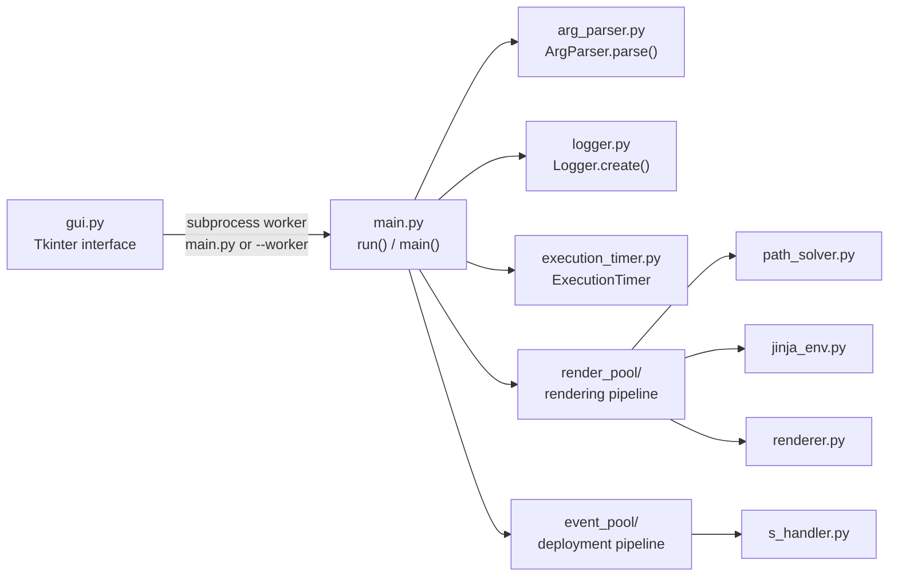

# `bin/` — application source

[← Back to the project README](../README.md)

Everything that makes up the Multiflora application lives here: the Tkinter
interface, the backend entry point, the rendering pipeline and the deployment
pipeline. The backend is started in two ways — directly from the command line,
or as a worker subprocess spawned by the GUI.

## Entry points

| File | Role |
| --- | --- |
| `gui.py` | Main application. Builds the whole interface, owns the project file lifecycle and spawns one backend worker per queue execution. Re-executes itself with `--worker` to run the backend in compiled mode. |
| `main.py` | Backend entry point (`main()` / `run()`). Executed by the command line and by the GUI worker; the same routine is used by both. |

## Module map



## Backend pipeline

`main()` orchestrates the whole run, always reporting the total elapsed time at
the end:

1. `ExecutionTimer.start()` and `ArgParser.parse()` — starts the stopwatch and
   reads the positional paths plus the execution mode.
2. `Logger.create(args.path)` — creates `logs/` inside the project directory
   and attaches the console and timestamped-file handlers.
3. `SHandler(logger).validate_inventory_hosts(...)` — loads
   `inventory.yaml` and rejects duplicate `hostname`/`config_file` values and
   unsupported platforms.
4. `PathSolver.solve(...)` — resolves the template path and creates the `cfg/`
   output directory.
5. `JinjaEnv.create(...)` — loads the Jinja2 template (returns `None` on
   failure).
6. `Renderer.render(...)` — writes one `cfg/<config_file>.cfg` per data file
   entry.
7. Finish according to the flags:
   - `--dry-run` (or no flag): stop after rendering;
   - `--deploy`: `await SHandler.connect(...)` applies every rendered file.

Failures are logged and the routine returns early; unexpected exceptions are
caught so the timer summary is always printed.

## Worker mode and GUI integration

The GUI never executes the backend in its own process. For every queue
execution it starts `execute_queue_logic()`, which:

1. requires the inventory to live inside a subdirectory of `config/` and uses
   that subdirectory as the worker's configuration path;
2. spawns the worker:
   - **compiled**: relaunches the application executable with
     `--worker <config_dir> <inventory> <data> <template> <name> --<mode>`;
   - **from source**: runs
     `python -u main.py <config_dir> <inventory> <data> <template> <name> --<mode>`
     with the current interpreter;
3. streams the worker stdout, forwarding each line to the queue logger and
   parsing it to update the device tree (statuses come from keywords such as
   `Validating host '<host>' with platform '<platform>'`, `Connecting`,
   `Applying`, `applied successfully`, `fail`, `error`, `timeout`).

In worker mode `gui.py` strips the `--worker` argument, enables line buffering
on stdout/stderr (so log lines reach the GUI immediately) and hands execution
to `main.run()`.

Removing a queue kills its worker process, so abandoned executions stop writing
logs into a tab that no longer exists.

## Logging

`Logger.create(path)` returns a DEBUG-level logger that writes simultaneously
to:

- the **console** (stream handler), which is what the GUI captures per queue;
- a **file** at `<path>/logs/<YYYY-MM-DD_HH-MM-SS>.log`.

`ExecutionTimer` measures the run with `time.perf_counter` and formats the
result as `HH:MM:SS.ss`; the summary line (`Total elapsed time: …`) is always
logged at the end.

<!-- Imagem: substituir por uma captura do log de execução do backend -->

## Command line usage

```bash
cd bin   # imports and relative paths resolve from here
python main.py <config_dir> <inventory> <data> <template> <queue_name> \
    [--dry-run | --simulate | --deploy]
```

| Argument / flag | Description |
| --- | --- |
| `config_dir` | Directory that receives `cfg/` and `logs/` |
| `inventory` | Inventory YAML file |
| `data` | YAML file with the template variables |
| `template` | Jinja2 template |
| `queue_name` | Name used in the log messages |
| `--dry-run` | Render the configurations without deploying them |
| `--simulate` | Reserved simulation mode (currently ignored by the backend) |
| `--deploy` | Render and deploy the configurations to the devices |

Without any flag the backend behaves like `--dry-run`: it renders and stops.

## Project files and caches

The GUI stores the workspace in plain JSON files. Two of them are internal and
live inside `config/`:

| File | Role |
| --- | --- |
| `.last_project.json` | Session cache, written whenever the project is saved or the application closes |
| `.autosave_project.json` | Continuous auto-save (every 30 s), used for crash recovery |

On startup the session cache is loaded; when it differs from the auto-save
cache the application offers to recover the pending changes. A project saved by
the user is stored as a regular `.json` file — the internal cache paths are
refused as destinations.

## Other notes

- Modules import each other by top-level name (`from render_pool.renderer import
  Renderer`), which relies on the `bin/` directory being the working directory
  or on the script being launched as `python bin/<script>.py` from the
  repository root.
- `path_solver.py` appends `bin/` itself to `sys.path`, so it also works when
  executed directly.
- Scrapli's own deprecation warnings are filtered out in
  `event_pool/s_handler.py` to keep the console output clean.
- Sample projects (`config/arista/`, `config/miniarista/`, `config/nokia/`)
  and the Containerlab topologies (the `clab/` folder inside each project) are
  documented in the
  [project README](../README.md#demo-labs-with-containerlab).
