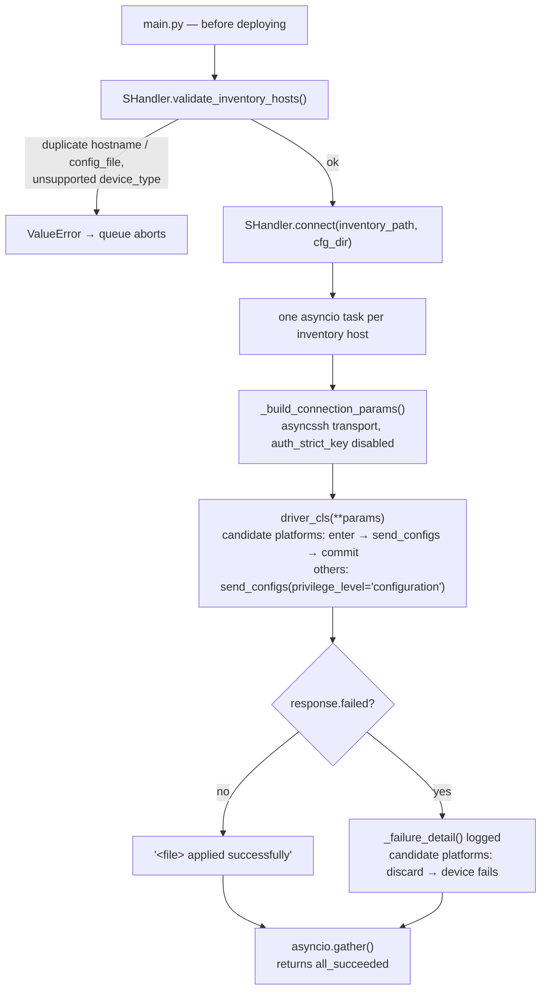

# `event_pool/` — deployment pipeline

[← Back to the application source](../README.md) · [← Back to the project README](../../README.md)

Applies the rendered configuration files to the network devices listed in the
inventory, using `scrapli` with the asynchronous `asyncssh` transport. One task
is created per host and all of them run concurrently; every step is reported
through the logger provided by the caller.

## Pipeline



## `SHandler`

| Method | Description |
| --- | --- |
| `__init__(logger=None)` | Stores the logger (falls back to the module logger) |
| `validate_inventory_hosts(inventory_hosts)` | Rejects duplicate hostnames/config files and unsupported platforms; raises `ValueError` |
| `connect(inventory_path, cfg_dir, inventory_hosts=None)` | Applies each host's configuration; returns `True` only when every host succeeded |
| `_get_driver(platform)` | Returns the asynchronous driver class for a `device_type` (raises `ValueError` when unknown) |
| `_build_connection_params(device_params, platform)` | Builds the driver keyword arguments |
| `_apply_configs_to_device(device_name, device_params, config_files)` | Connects to one device and sends its configuration file |
| `_failure_detail(response)` | Extracts the first failed command and its first output line for the log |

### Validation

`validate_inventory_hosts()` walks `all.hosts` and logs every entry as

```
Validating host '<name>' with platform '<device_type>' ...
```

(the GUI parses this line to create the devices in the side bar). It collects:

- **duplicates**: two hosts sharing the same `hostname` or `config_file`
  (`.cfg` appended before comparing);
- **invalid platforms**: a `device_type` not present in `DRIVER_MAP`.

Any finding aborts the queue with a `ValueError`, which the backend logs as
`Inventory validation failed`.

### Connection parameters

`_build_connection_params()` produces the driver keyword arguments:

| Parameter | Value |
| --- | --- |
| `host` / `port` | `host` (required) and `port` (default `22`) |
| `auth_username` / `auth_password` | `username` / `password` (required) |
| `auth_secondary` | `auth_secondary` (enable password); falls back to `password` with a warning |
| `auth_strict_key` | Always `False` (lab-friendly) |
| `transport` | `asyncssh` |
| `transport_options` | Extra `asyncssh` options; forced for `nokia_srlinux` (`term_size`, required by the SR Linux CLI) |

### Applying a configuration

For each host, `connect()` resolves the configuration file as
`<cfg_dir>/<config_file>.cfg` (using `config_file`, then `hostname`, then the
host name itself), and `_apply_configs_to_device()`:

1. opens the driver connection and logs `[<host>] Connecting to <host>...`;
2. reads the configuration file, discarding blank lines and comment lines
   starting with `!` or `#`;
3. on candidate-based platforms, enters the candidate configuration first
   (`enter_candidate()`, taking over and clearing a candidate left dirty by an
   aborted session);
4. sends the remaining lines with `send_configs(..., privilege_level=
   "configuration")`;
5. on `response.failed`, extracts the first failed command and its first
   non-empty output line (`_failure_detail`), discards the staged changes on
   candidate-based platforms and logs `[<host>] Failed to apply <file>:
   <detail>`;
6. on candidate-based platforms, commits the staged changes (`commit()`;
   a failed commit discards them and raises);
7. on success, logs `[<host>] <file> applied successfully` and
   `[<host>] Connection closed.`.

All tasks are awaited with `asyncio.gather`; each device handles its own
exceptions, so one failure never stops the others. `connect()` returns `False`
when at least one host failed.

### Error handling

| Exception | Logged as |
| --- | --- |
| `ScrapliCommandFailure` | Device rejected the configuration (candidate could not be entered, or the commit failed) |
| `ScrapliConnectionNotOpened` | Could not establish an interactive session (prompt not recognized — check the platform privilege patterns) |
| `ScrapliAuthenticationFailed` | Authentication failed |
| `ScrapliTimeout` | Connection timed out |
| `ScrapliConnectionError` | Connection error |
| Any other exception | Unexpected error during connection |

scrapli's deprecation warnings are filtered at import time to keep the console
output clean.

## Inventory fields used

```yaml
all:
  hosts:
    r1:
      device_type: arista_ceos   # driver selection
      host: 10.98.0.3            # connection target
      port: 22
      username: admin
      password: admin
      auth_secondary: admin      # optional enable password
      hostname: r1               # fallback for the config file name
      config_file: r1.cfg        # file applied to this device
```

The same naming rule is used by the [rendering pipeline](../render_pool/README.md),
which is why `config_file` must be unique across the inventory.

## Supported platforms

| `device_type` | Driver |
| --- | --- |
| `arista_eos` | `scrapli.driver.core.AsyncEOSDriver` |
| `arista_ceos` | `scrapli.driver.core.AsyncEOSDriver` |
| `nokia_srlinux` | `AsyncSRLinuxDriver` (defined in `s_handler.py`) |

Platforms are mapped in `DRIVER_MAP`; adding a new vendor means adding its
asynchronous driver class there (and no changes elsewhere).

### Nokia SR Linux driver

`AsyncSRLinuxDriver` subclasses `AsyncNetworkDriver` with the privilege levels
shipped by `scrapli_community.nokia.srlinux` (`exec` → `configuration`) and
adds the candidate-datastore handling:

| Method | Description |
| --- | --- |
| `enter_candidate()` | Enters the exclusive candidate (`enter candidate exclusive`); answers the confirmation of a non-empty candidate automatically and discards the stale changes (left behind by an aborted session) so the deployment always starts from a clean candidate; raises `ScrapliCommandFailure` when another session still holds the candidate |
| `commit()` | Sends `commit now` (commits and leaves candidate mode), then re-syncs the privilege state; raises `ScrapliCommandFailure` with the device output when the commit fails |
| `discard()` | Leaves the candidate discarding the staged changes (`discard now` via `acquire_priv("exec")`) |

Because every failure leaves the candidate in a known state — discarded — the
next deploy never commits changes staged by an earlier, interrupted one.

<!-- Imagem: substituir por uma captura dos status de deploy no painel -->
