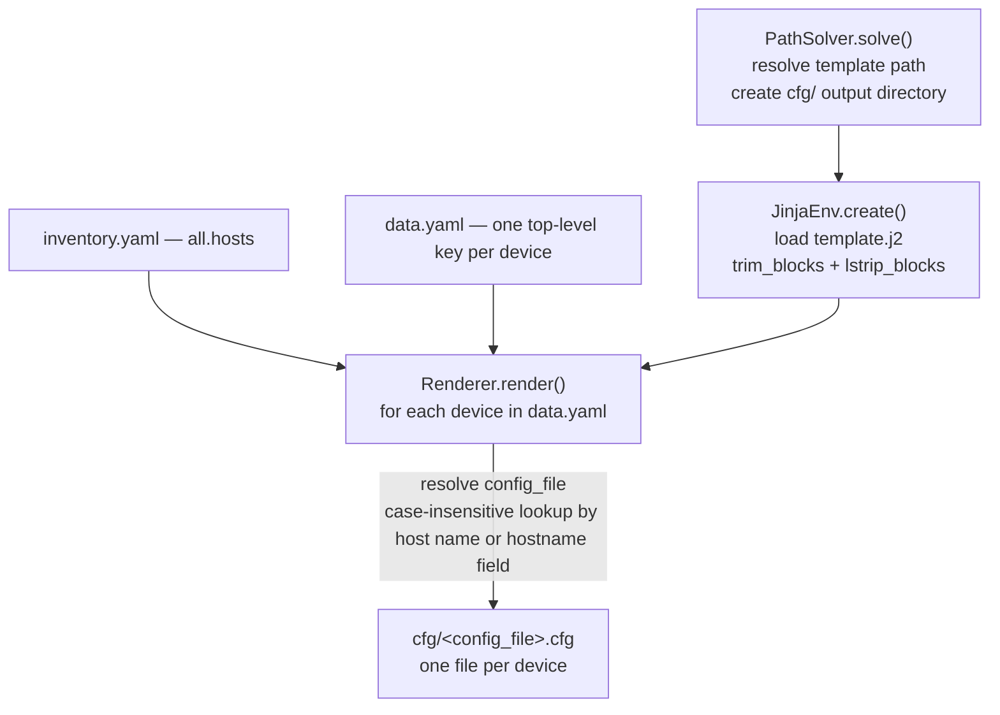

# `render_pool/` — rendering pipeline

[← Back to the application source](../README.md) · [← Back to the project README](../../README.md)

Turns a Jinja2 template plus a YAML data file into one ready-to-deploy `.cfg`
file per device. The inventory is used only to discover the output file name of
each device.

## Pipeline



In the backend (`bin/main.py`) the call order is:

1. `PathSolver.solve(args.path, args.template, args.inventory, logger)`
2. `JinjaEnv.create(template_path, logger)`
3. `Renderer.render(template, args.data_file, cfg_dir, logger, inventory_hosts)`

## Classes

### `PathSolver.solve(path, template_file, inventory_file, logger)`

Resolves the filesystem paths used by the pipeline and makes sure the output
directory exists:

- the template path is resolved against the current working directory;
- a `cfg/` subdirectory is created inside `path` (recursively) to receive the
  rendered files;
- the inventory path is returned as-is (possibly relative).

Returns the tuple `(template_path, cfg_dir, inventory_path)`.

### `JinjaEnv.create(template_path, logger)`

Builds the Jinja2 environment and loads the template:

- `FileSystemLoader` searching the directory that contains the template file,
  so ``/`` referencing sibling files work;
- `trim_blocks` and `lstrip_blocks` enabled — block tags consume the newline
  after them (and the indentation before them), so the rendered configuration
  has no stray blank lines;
- returns the loaded template, or `None` when the file cannot be read or
  parsed (the error is logged).

### `Renderer.render(template, data_file, cfg_dir, logger, inventory_hosts=None)`

Renders the template once per top-level key of the data file:

1. loads `data_file` with `yaml.safe_load` (an empty document becomes an empty
   mapping);
2. for each key, tries to find the matching inventory entry — first by
   lower-cased key, then by scanning for a name or `hostname` field that
   matches case-insensitively;
3. chooses the output file name from the entry's `config_file`; without an
   inventory match the key itself is used. `.cfg` is appended when missing;
4. writes `cfg_dir/<config_file>` with `template.render(device_data)`.

Returns `True` when every device was rendered and `False` when the data file
could not be loaded or at least one device failed; individual failures are
logged and do not stop the remaining devices.

## Input model

`data.yaml` — every top-level key is a device; the value is the variable set
handed to the template:

```yaml
r1:
  hostname: r1
  interfaces:
    - name: Ethernet1
      description: Uplink
      ip_address: 10.255.0.2
```

`inventory.yaml` — only the file-name resolution matters here:

```yaml
all:
  hosts:
    r1:
      hostname: r1
      config_file: r1.cfg   # output file for the data key "r1"
```

Missing variables follow Jinja2's default `Undefined` behaviour: they are
printed/iterated as empty and only raise errors when their attributes are
accessed.

## Output

```
<config_dir>/
├── cfg/
│   ├── r1.cfg
│   ├── r2.cfg
│   └── ...
├── inventory.yaml
├── data.yaml
└── template.j2
```

Each `.cfg` is a plain-text configuration, ready to be applied by the
[deployment pipeline](../event_pool/README.md) — the deploy step skips blank
lines and comment lines starting with `!`.

<!-- Imagem: substituir por uma captura dos arquivos renderizados -->

## Error handling

| Situation | Behaviour |
| --- | --- |
| Data file missing/invalid YAML | `render` returns `False`; error logged |
| Template not loadable | `JinjaEnv.create` returns `None`; backend aborts before rendering |
| A single device fails to render | Error logged, remaining devices still render, `render` returns `False` |
| Data key without inventory entry | File name falls back to the key itself |
